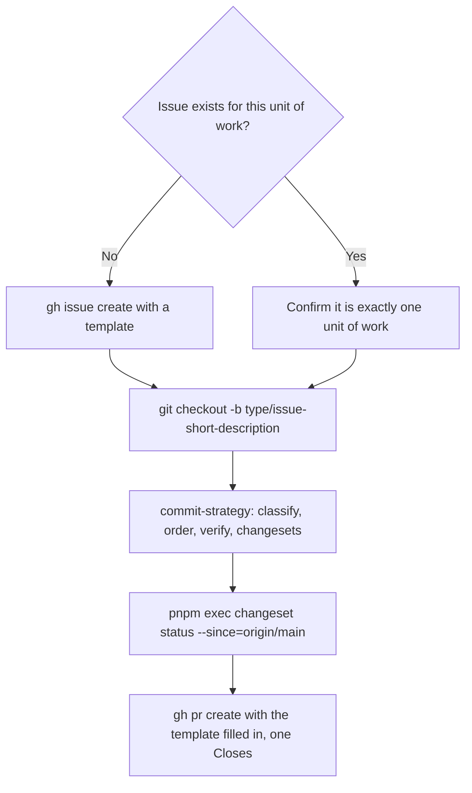

# PR strategy

Turn a working tree into one PR that closes exactly one issue, with a conventionally named
branch, ordered commits, the changesets the change needs, and a filled-in template.

This skill does not order or verify commits or decide bump types; that is
[`commit-strategy`](../commit-strategy/SKILL.md). It does not move issues on any board.



## 1. Confirm the one issue

1. If the user gave an issue number, use it. Do not create a duplicate.
2. Otherwise search: `gh issue list --search "<topic>" --state open`, and reuse a match.
3. Otherwise create one from a template; blank issues are disabled:
   ```
   gh issue create --template "<01-feature|02-enhancement|03-fix>.yml" \
     --title "<type>(<scope>): <summary>" --assignee @me
   ```
4. If the work covers more than one unit (two unrelated packages for unrelated reasons), stop and
   split it into separate issues **before** writing code. Finding the split after the commits
   exist means re-sequencing them.

## 2. Branch

`<type>/<issue-number>-short-description`, with `<type>` matching the issue template
(`feature`, `enhancement`, `fix`). Branch names do not link issues automatically.

## 3. Commit

Run [`commit-strategy`](../commit-strategy/SKILL.md). Every commit on the branch belongs to the
one issue, so no per-commit `Refs #` trailer is needed. Conventional-commit subjects
(`feat(readthrough): ...`, `fix(...)`, `docs(...)`, `ci(...)`, `chore(...)`).

## 4. Changesets

Before opening the PR, a changeset exists for every changed module listed in a publish config,
and `pnpm exec changeset status --since=origin/main` passes. CI's `changeset-checks` is the real
gate. A README-only PR needs no changeset and starts no workflow.

## 5. Open the PR

```
gh pr create --title "<type>(<scope>): <summary>" --assignee @me --body-file <file>
```

Fill every section of `.github/PULL_REQUEST_TEMPLATE.md`:

- **Linked Issue:** exactly one closing keyword, `Closes #<n>` (or `Fixes` / `Resolves`).
- **What changed? / Why?:** real text, not the placeholder.
- **How was this tested?:** tick boxes honestly. "Not tested" needs a reason in the section.
- **Risk & Rollback:** non-empty, even briefly, for every PR.

If the change alters a package's documented behaviour, say so in **What changed?** and name the
README sections updated.

## Guardrails

Always

- Trace the PR to exactly one issue, created from a template.
- Name the branch `<type>/<issue-number>-short-description`.
- Use exactly one closing keyword for exactly one issue.
- Keep a core module free of third-party dependencies.
- Carry changesets before opening the PR.

Never

- Link more than one issue to a PR, or merge two units of work into one issue to dodge the rule.
- Open a PR without a linked issue, or reference the issue only in a comment.
- Create a blank issue.
- Push to `main` or force-push a shared branch.
- Edit `.changeset/config.json`'s `ignore` list by hand (it is generated).

## Definition of done

- One open, templated issue is linked, with one `Closes #<issue>` line in the PR body.
- The branch follows the naming convention.
- Commits are ordered and each builds (`pnpm turbo run build lint check-types test`).
- Changesets exist for every eligible changed module and `changeset status` passes.
- The PR body follows the template in full.
